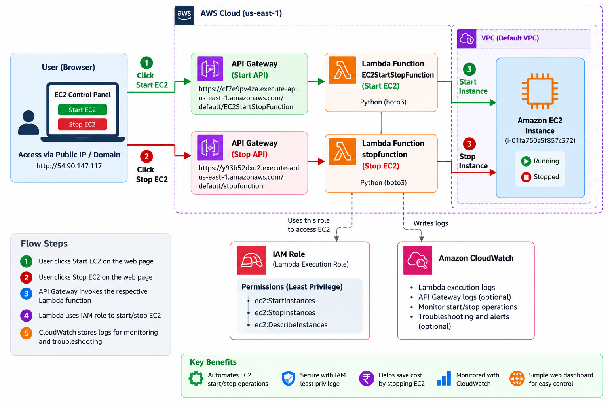

# AWS EC2 Start/Stop Automation Using Lambda, API Gateway, and HTML

A beginner-friendly AWS Cloud/DevOps project that lets a user request **Start EC2** or **Stop EC2** from a simple web page. Two separate API Gateway endpoints invoke two separate AWS Lambda functions, which use Python and Boto3 to request the EC2 state change.

> **Important:** This repository is a learning/demo project. Before making it public or using it beyond a lab, secure the API endpoints with suitable authorization and remove account-specific information from screenshots and configuration examples.

---

## Table of Contents

1. [Project Overview](#1-project-overview)
2. [Architecture](#2-architecture)
3. [AWS Services Used](#3-aws-services-used)
4. [Project Flow](#4-project-flow)
5. [Repository Structure](#5-repository-structure)
6. [Prerequisites](#6-prerequisites)
7. [Step 1 — Prepare the EC2 Instance](#step-1--prepare-the-ec2-instance)
8. [Step 2 — Create the IAM Policy and Lambda Roles](#step-2--create-the-iam-policy-and-lambda-roles)
9. [Step 3 — Create the Start Lambda Function](#step-3--create-the-start-lambda-function)
10. [Step 4 — Create the Stop Lambda Function](#step-4--create-the-stop-lambda-function)
11. [Step 5 — Create API Gateway Endpoints](#step-5--create-api-gateway-endpoints)
12. [Step 6 — Configure the HTML Dashboard](#step-6--configure-the-html-dashboard)
13. [Step 7 — Host the Dashboard on EC2](#step-7--host-the-dashboard-on-ec2)
14. [Step 8 — Test the Project](#step-8--test-the-project)
15. [Monitoring and Logs](#monitoring-and-logs)
16. [Troubleshooting](#troubleshooting)
17. [Security Best Practices](#security-best-practices)
18. [Cost Notes](#cost-notes)
19. [Screenshots](#screenshots)
20. [Future Improvements](#future-improvements)

---

## 1. Project Overview

### Objective

Build a small web dashboard with two controls:

- **Start EC2 Instance** — invokes the Start API, which invokes the Start Lambda function.
- **Stop EC2 Instance** — invokes the Stop API, which invokes the Stop Lambda function.

The Lambda functions request a state transition for a specific EC2 instance. The user can then verify the final state in the AWS EC2 console.

### Features

- Two separate Lambda functions for clear responsibility separation.
- Two separate API Gateway endpoints.
- Simple HTML/CSS/JavaScript dashboard.
- IAM execution roles with limited EC2 permissions.
- CloudWatch logs for troubleshooting.
- Manual testing through the Lambda console and browser.
- Screenshot evidence for a GitHub portfolio.

### Expected result

The dashboard shows Start and Stop controls. Clicking a control sends a request to its configured API endpoint. A successful HTTP response means the API request was accepted; **it does not necessarily mean the instance has already reached its final state**. Confirm `running` or `stopped` in the EC2 console.

---

## 2. Architecture



### Request paths

**Start path**

`Browser → Start API Gateway → EC2StartStopFunction → Amazon EC2`

**Stop path**

`Browser → Stop API Gateway → stopfunction → Amazon EC2`

### Supporting services

- **IAM:** The Lambda execution role authorizes the required EC2 actions.
- **CloudWatch Logs:** Stores Lambda execution logs and errors.
- **EC2:** The target virtual machine.
- **Apache/httpd:** Serves `index.html` if you host the page on an Amazon Linux EC2 instance.

### Example project configuration

The screenshots supplied for this project show the AWS Region `us-east-1` (N. Virginia) and EC2 instance ID `i-01fa750a5f857c372`.

The screenshots also show these API Gateway invoke URLs:

- Start: `https://cf7e9pv4za.execute-api.us-east-1.amazonaws.com/default/EC2StartStopFunction`
- Stop: `https://y93b52dxu2.execute-api.us-east-1.amazonaws.com/default/stopfunction`

These are account-specific demo endpoints. **Verify the URLs in your own AWS console before use.** Replace them in `index.html` if your endpoints differ. Avoid publishing endpoints or screenshots publicly unless you intend to expose them; use API authorization regardless.

---

## 3. AWS Services Used

| Service | Purpose |
|---|---|
| Amazon EC2 | Virtual machine that is started or stopped |
| AWS Lambda | Runs Python code in response to API requests |
| Amazon API Gateway | Exposes separate HTTP API endpoints for the Start and Stop actions |
| AWS IAM | Grants Lambda permission to call EC2 APIs |
| Amazon CloudWatch Logs | Captures Lambda execution output and errors |
| Amazon Linux + Apache | Optional web hosting for the HTML dashboard |
| GitHub | Stores project source code and documentation |

---

## 4. Project Flow

1. The user opens the web dashboard.
2. The user clicks **Start EC2 Instance** or **Stop EC2 Instance**.
3. JavaScript sends an HTTP `POST` request to the matching API Gateway endpoint.
4. API Gateway invokes the corresponding Lambda function.
5. Lambda uses Boto3 to call `StartInstances` or `StopInstances`.
6. The Lambda execution role authorizes the action.
7. Lambda returns an HTTP response.
8. CloudWatch Logs captures execution details.
9. The user checks the EC2 console to verify the final instance state.

---

## 5. Repository Structure

```text
aws-ec2-start-stop-automation/
├── index.html
├── lambda/
│   ├── start_ec2.py
│   ├── stop_ec2.py
│   └── iam-policy-example.json
├── docs/
│   ├── architecture.png
│   └── screenshots/
│       ├── 01-start-lambda-code.png
│       ├── 02-start-lambda-api-trigger.png
│       ├── 03-stop-lambda-code.png
│       ├── 04-stop-lambda-api-trigger.png
│       ├── 05-iam-policy.png
│       ├── 06-ec2-running.png
│       ├── 07-dashboard-home.png
│       ├── 08-stop-confirmation.png
│       └── 09-ec2-stopping.png
├── .gitignore
└── README.md
```

---

## 6. Prerequisites

Before starting, make sure you have:

- An AWS account.
- Permission to create EC2 instances, Lambda functions, API Gateway APIs, and IAM roles/policies.
- One test EC2 instance.
- Basic familiarity with the AWS Management Console.
- A GitHub account for storing the project.
- A browser to test the HTML page.

Use a **test instance only**. Do not test stop actions against a production server.

---

## Step 1 — Prepare the EC2 Instance

1. Open the [Amazon EC2 console](https://console.aws.amazon.com/ec2/).
2. Select the Region where your instance exists. The screenshots use **US East (N. Virginia), `us-east-1`**.
3. Select your test instance or launch a new one.
4. Record the instance ID. Example: `i-01fa750a5f857c372`.
5. Confirm the instance is in the expected state before testing.

### Optional: Install Apache on Amazon Linux

Connect to your test EC2 instance using SSH or EC2 Instance Connect, then run:

```bash
sudo dnf install -y httpd
sudo systemctl enable --now httpd
sudo systemctl status httpd
```

If your Amazon Linux version uses `yum`, you can use `sudo yum install -y httpd`.

The purpose of these commands:

- `dnf install -y httpd` installs Apache.
- `systemctl enable --now httpd` starts Apache now and enables it at boot.
- `systemctl status httpd` checks the service status.

The default web root is `/var/www/html`.

> **Important architecture limitation:** If you host the dashboard on the same EC2 instance that you stop, the dashboard will be unavailable while that instance is stopped. To keep the control page available, host it separately, for example using private/authenticated static hosting or a separate web server.

---

## Step 2 — Create the IAM Policy and Lambda Roles

Lambda needs permission to call the EC2 API. Use an execution role rather than storing AWS access keys in Python or HTML.

### Create a policy

1. Open the [IAM console](https://console.aws.amazon.com/iam/).
2. Select **Policies → Create policy → JSON**.
3. Use the example in [`lambda/iam-policy-example.json`](lambda/iam-policy-example.json).
4. Update the account ID, Region, and instance ID to match your environment.
5. Review the policy and create it.

The policy allows:

- `ec2:StartInstances` for the specified instance.
- `ec2:StopInstances` for the specified instance.
- `ec2:DescribeInstances` for reading instance information.

`DescribeInstances` uses `"Resource": "*"` because that action does not support the same instance-level resource restriction as start/stop. Keep the permissions as narrow as AWS supports.

### Create Lambda execution roles

Create an execution role for each Lambda function, or use one role if you intentionally want to share permissions:

1. In IAM, choose **Roles → Create role**.
2. Select **AWS service → Lambda**.
3. Attach the EC2 policy.
4. Attach `AWSLambdaBasicExecutionRole` so Lambda can write to CloudWatch Logs.
5. Name the role clearly, for example:
   - `EC2StartLambdaRole`
   - `EC2StopLambdaRole`

Attach each role to the corresponding Lambda function under **Configuration → Permissions**.

If you get `UnauthorizedOperation`, verify that the policy is attached to the exact execution role used by the function. Also check for permission boundaries, AWS Organizations service control policies, or explicit denies.

---

## Step 3 — Create the Start Lambda Function

1. Open the [AWS Lambda console](https://console.aws.amazon.com/lambda/).
2. Choose **Create function → Author from scratch**.
3. Function name: `EC2StartStopFunction`.
4. Select a currently supported Python runtime.
5. Choose the Start execution role created in Step 2.
6. Create the function.
7. Open the code editor and use the example in [`lambda/start_ec2.py`](lambda/start_ec2.py).
8. Update `REGION` and `INSTANCE_ID` to match your EC2 instance.
9. Click **Deploy**.

### What the code does

- Creates a Boto3 EC2 client in the selected Region.
- Calls `ec2.start_instances()` for the configured instance ID.
- Returns a JSON response with the instance ID and requested state.
- Returns an HTTP status and CORS headers for the browser example.

### Test the Start function

In the Lambda console, select **Test → Create new event** and use:

```json
{}
```

This example handler is designed to start the configured instance when invoked directly. Click **Test** and then check the EC2 console.

A successful API call may report an intermediate state such as `pending`. Wait for EC2 to reach `running`.

---

## Step 4 — Create the Stop Lambda Function

1. In Lambda, create another function named `stopfunction`.
2. Use a currently supported Python runtime.
3. Attach the Stop execution role.
4. Copy the example from [`lambda/stop_ec2.py`](lambda/stop_ec2.py) into the function.
5. Update `REGION` and `INSTANCE_ID`.
6. Click **Deploy**.

### What the code does

- Creates an EC2 client using Boto3.
- Calls `ec2.stop_instances()` for the configured instance.
- Returns a JSON response describing the requested state.
- Writes exceptions to the Lambda execution logs when a failure occurs.

### Test the Stop function

The example Stop handler can be invoked directly with an empty test event:

```json
{}
```

Click **Test** and check the EC2 console. The state may show `stopping` before it reaches `stopped`.

> Stopping an instance can interrupt running workloads and may change the public IPv4 address when the instance is started again if it uses an auto-assigned public IP. Confirm any DNS or IP dependencies before testing.

---

## Step 5 — Create API Gateway Endpoints

Create a separate API Gateway endpoint for each Lambda function.

### Start API

1. Open the [API Gateway console](https://console.aws.amazon.com/apigateway/).
2. Create or select the API integrated with `EC2StartStopFunction`.
3. Confirm the route/resource and HTTP method used by your API.
4. Confirm the integration points to the Start Lambda function.
5. Deploy or update the API if required.
6. Copy the API invoke URL.

### Stop API

Repeat the process for `stopfunction` and copy its invoke URL.

### Configure CORS

Because the dashboard calls the API from a browser, configure CORS for the origin serving your page.

- Allow the `POST` method and `OPTIONS` preflight request.
- Allow the `Content-Type` request header.
- Configure the correct `Access-Control-Allow-Origin` value for your site.
- Ensure the CORS configuration matches the API type and its integration response configuration.

The sample Lambda handlers include basic CORS headers, but **CORS must be configured correctly at API Gateway as well when required by the API type**. CORS is not authentication and does not prevent non-browser clients from calling a public API.

### Verify API behavior

Use the API Gateway console and Lambda logs to confirm each endpoint invokes the correct function. Do not assume an endpoint is configured correctly just because its URL is visible in the console.

---

## Step 6 — Configure the HTML Dashboard

Open [`index.html`](index.html).

Set these constants to the exact API Gateway invoke URLs copied from your AWS console:

```javascript
const START_API_URL = "YOUR_START_API_GATEWAY_URL";
const STOP_API_URL  = "YOUR_STOP_API_GATEWAY_URL";
```

The Start button must use the Start API URL, and the Stop button must use the Stop API URL.

The JavaScript sends a JSON request:

```json
{
  "action": "start"
}
```

or

```json
{
  "action": "stop"
}
```

The provided Lambda examples perform their dedicated action regardless of the request body. The `action` field is included so the browser request is easy to understand and can be validated if you later consolidate the handlers.

### Check the HTML

Confirm:

- Both API URLs are correct.
- The Start button calls the Start endpoint.
- The Stop button calls the Stop endpoint.
- The browser shows a useful success or error message.
- The browser developer console contains no CORS or JavaScript errors.

---

## Step 7 — Host the Dashboard on EC2

On the EC2 machine used for hosting the page, copy the HTML file to Apache's document root:

```bash
sudo mkdir -p /var/www/html
sudo cp index.html /var/www/html/index.html
sudo systemctl enable --now httpd
```

If you are editing directly on the server, you can use:

```bash
sudo nano /var/www/html/index.html
```

Save in Nano with **Ctrl+O**, press **Enter**, then **Ctrl+X**.

### Security group

For a basic HTTP lab, allow inbound TCP port `80` only from an appropriate source. Do not open SSH to the entire internet unless you have a specific need and compensating security controls.

Visit:

```text
http://YOUR_WEB_SERVER_PUBLIC_IP
```

Replace the placeholder with your web server's public IP or domain.

### Important

Do not use the target instance as the only host for the dashboard if you need to stop and later restart that same instance through the dashboard. The page will be unavailable while its host is stopped. Host the dashboard separately for reliable control.

---

## Step 8 — Test the Project

Use a test instance and follow this sequence.

### Test A — Start from Lambda

1. Open `EC2StartStopFunction`.
2. Run its test event.
3. Check the result in the Lambda console.
4. Open EC2 and wait until the state is `running`.

### Test B — Stop from Lambda

1. Open `stopfunction`.
2. Run its test event.
3. Check the result.
4. Open EC2 and wait until the state is `stopped`.

### Test C — Start from the web dashboard

1. Start the target EC2 instance if it is stopped.
2. Open the dashboard.
3. Click **Start EC2 Instance**.
4. Confirm the browser's confirmation prompt.
5. Check the response message.
6. Confirm the final state in EC2.

### Test D — Stop from the web dashboard

1. Make sure the target is a test instance and it is safe to stop.
2. Click **Stop EC2 Instance**.
3. Confirm the prompt.
4. Check the response message.
5. Confirm the instance reaches `stopped` in the EC2 console.

### What counts as a successful test?

- The correct API endpoint is called.
- The correct Lambda function runs.
- The function has permission to call EC2.
- EC2 transitions to the expected final state.
- CloudWatch contains logs that help diagnose the invocation.

A browser message such as “request submitted” alone does not prove the final EC2 state.

---

## Monitoring and Logs

Lambda sends logs to CloudWatch when its execution role includes the required logging permissions.

1. Open the [CloudWatch console](https://console.aws.amazon.com/cloudwatch/).
2. Select **Logs → Log groups**.
3. Open `/aws/lambda/EC2StartStopFunction` or `/aws/lambda/stopfunction`.
4. Open the latest log stream.
5. Review errors and invocation details.

Common errors include:

- `UnauthorizedOperation` — missing or blocked IAM permission.
- `InvalidInstanceID.NotFound` — incorrect instance ID or Region.
- CORS errors in the browser — origin, method, headers, or API response configuration needs attention.
- `403` or `500` API responses — inspect API Gateway execution details and Lambda logs.
- `502` or malformed proxy response — verify the Lambda return format expected by the API integration.

---

## Troubleshooting

| Problem | Likely cause | What to check |
|---|---|---|
| Lambda gets `UnauthorizedOperation` | Execution role lacks permissions or a policy blocks the action | Lambda Configuration → Permissions; attached policies; permission boundaries and organization policies |
| Instance ID not found | Wrong ID or Region | Compare the configured ID and Region with the EC2 console |
| Clicking the button does nothing | JavaScript error or wrong HTML | Browser developer console and `index.html` |
| Browser reports CORS error | CORS is not configured for the website origin/method/headers | API Gateway CORS configuration and Lambda response |
| API returns 403 | Authorization, resource policy, or API configuration | API Gateway authorization and access logs |
| API returns 5xx | Lambda exception or integration problem | Lambda CloudWatch logs and API integration settings |
| Dashboard disappears after Stop | Dashboard is hosted on the target instance | Host the dashboard on a separate service |
| Start/Stop returns intermediate state | EC2 transitions are asynchronous | Wait and refresh the EC2 console |

---

## Security Best Practices

- **Do not put AWS access keys in HTML or JavaScript.** Browser code is visible to every visitor.
- Use IAM execution roles for Lambda.
- Restrict `StartInstances` and `StopInstances` to the intended instance where supported.
- Protect API Gateway with suitable authorization. Do not leave a public unauthenticated endpoint that can control compute resources.
- CORS is not a security boundary or authentication mechanism.
- Validate requests and only allow expected actions.
- Avoid public exposure of account IDs, instance IDs, internal IPs, screenshots, and operational details unless intentionally shared.
- Do not commit `.pem` files, credentials, tokens, `.env` files, or private configuration.
- Use a separate dashboard host if the target EC2 instance must be stoppable.
- Test with a non-production instance first.

---

## Cost Notes

- EC2 compute charges generally stop while an eligible instance is in the `stopped` state.
- EBS volumes and snapshots can continue to incur charges.
- Public IPv4 addresses and other attached services may have separate charges depending on configuration.
- Lambda, API Gateway, CloudWatch, and web hosting may also incur usage-based charges.
- Review the AWS pricing pages and billing dashboard for your account and Region.

Stopping an instance can reduce compute costs, but it does not mean every resource associated with the instance becomes free.

---

## Screenshots

Project evidence is stored under [`docs/screenshots/`](docs/screenshots/).

Recommended evidence to capture and keep updated:

1. Start Lambda code and test success.
2. Stop Lambda code and test success.
3. Both API Gateway triggers and invoke URLs.
4. IAM execution role and least-privilege permissions.
5. Dashboard with Start and Stop controls.
6. EC2 `running` state after Start.
7. EC2 `stopped` state after Stop.
8. CloudWatch log streams showing successful requests.

Remove sensitive account details before making screenshots public.

---

## Future Improvements

- Add authentication/authorization to API Gateway.
- Add API request validation and structured error responses.
- Show current EC2 state on the dashboard using a protected status endpoint.
- Add confirmation, loading indicators, and clearer error handling.
- Add CloudWatch alarms and optional SNS notifications.
- Add scheduled start/stop with Amazon EventBridge Scheduler.
- Deploy infrastructure using AWS SAM, CloudFormation, or Terraform.
- Add GitHub Actions for linting and automated deployment.
- Add unit tests and a documented rollback process.

---

## Learning Outcomes

After completing this project, you should understand:

- How Lambda invokes AWS service APIs using Boto3.
- How IAM execution roles control Lambda permissions.
- How API Gateway exposes HTTP endpoints.
- How a browser calls an API using JavaScript `fetch`.
- How to inspect Lambda logs in CloudWatch.
- Why authentication, least privilege, and secure API configuration matter.
- How to document and publish a cloud project on GitHub.

---

## Author

**Project:** AWS EC2 Start/Stop Automation  
**Category:** Cloud Computing / DevOps  
**Language:** Python, HTML, CSS, JavaScript  
**Platform:** AWS

If you fork or adapt this project, update the Region, instance ID, API URLs, IAM permissions, and screenshots to match your own deployment.
